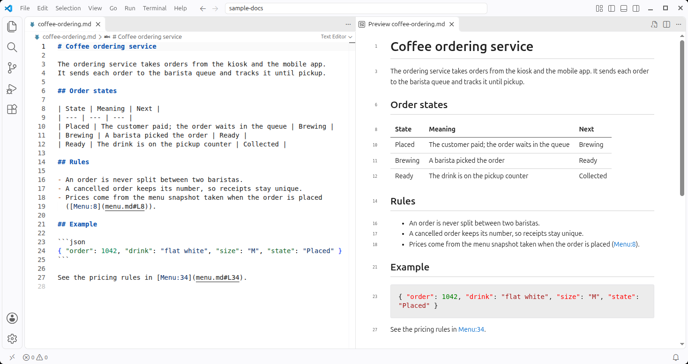
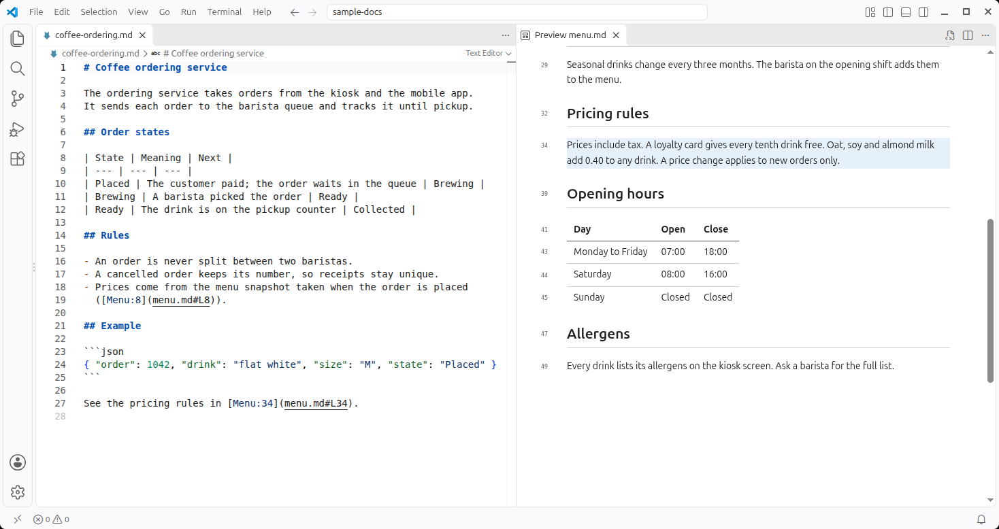

# Markdown Preview Line Numbers

A small VS Code extension for the built-in Markdown preview. It:

- Shows the source line number next to each block (heading, paragraph, list item, table row, code block).
- Scrolls to a line when you click a link with a line fragment, such as `[Menu:34](menu.md#L34)` or `[see](#L42)`. The target block stays highlighted until the next jump.
- Opens a file at a line from a link outside VS Code (chat, terminal, browser): `vscode://rado.markdown-line-numbers/open?path=<absolute path>&line=<line>`. A Markdown file opens in the preview, scrolled to the line and highlighted.

Source on the left, preview with line numbers on the right:



After clicking the `Menu:34` link, the preview opens `menu.md` and highlights the block at line 34:



## Install

```bash
./build.sh --install
```

Then run **Developer: Reload Window** in VS Code.

To remove it: `code --uninstall-extension rado.markdown-line-numbers`.

## How it works

The extension contributes a stylesheet and a script to the Markdown preview (`markdown.previewStyles` and `markdown.previewScripts`), plus one URI handler in `extension/extension.js`.

- **Line numbers.** The preview marks each block with a 0-based `data-line` attribute. The script copies it to `data-ln` as a 1-based number, and the CSS draws it in the left gutter. Containers (tables, lists, quotes) are skipped, because their first child already shows the same number.
- **Line links.** Fragments `#L163`, `#L163,5` and `#L163-L170` are supported. The preview scrolls to the last block that starts at or before the line.
- **Links to other files.** When `*.md` opens in the "Markdown Preview" custom editor, VS Code drops the `#L163` fragment before the new preview loads. To work around this, the preview you click stores the target path and line in `localStorage`. The preview that opens reads it (valid for 15 seconds). Previews of the same kind share an origin, so they share `localStorage`.
- **Links from outside VS Code** (chat, terminal, browser). A `vscode://file/<path>:<line>` link loses the line when `*.md` opens in the preview. Use `vscode://rado.markdown-line-numbers/open?path=<absolute path>&line=<line>` instead (`&column=<n>` is optional). The handler closes any open preview of the file, opens the text editor at the line, reopens the file in the preview, and closes the text tab it opened. A preview applies its start line only when it is created, and it starts at the top line the text editor showed last. To highlight the block, the handler writes `jump.js` (path, line, time) into the installed extension folder; the new preview loads it with its own nonce and highlights the block if the path matches and the jump is under 15 seconds old. Other file types stay in the text editor at the line. The first time, VS Code asks whether to allow the extension to open the URI.

## Links from Claude Code

To make Claude Code write chat links that open Markdown files at a line, add these lines to your `CLAUDE.md` (for all projects: `~/.claude/CLAUDE.md`):

```markdown
- When a link to a local file points at a specific line, use a form VS Code opens at that line:
  - Chat output, Markdown target (`.md`): `vscode://rado.markdown-line-numbers/open?path=<absolute path>&line=<line>` (add `&column=<n>` if useful), e.g. `[plan.md:42](vscode://rado.markdown-line-numbers/open?path=/home/me/project/docs/plan.md&line=42)`. `*.md` opens in the Markdown preview, which ignores the line of a `vscode://file` link; the handler in the `markdown-line-numbers` extension scrolls the preview to the line and highlights it.
  - Chat output, any other file: `vscode://file/<absolute path>:<line>` (add `:<column>` if useful), e.g. `[Foo.java:42](vscode://file/home/me/project/src/Foo.java:42)`. A `file://` URL cannot carry a line number.
  - Markdown files on disk: relative path with a `#L<line>` fragment, e.g. `[Foo.java:42](../src/Foo.java#L42)`.
```

Notes:

- The `path` value is a plain absolute path, starting with `/`. Spaces, `&`, `+` and `#` in a path must be percent-encoded (`%20`, `%26`, `%2B`, `%23`).
- The `.md` rule matters only when `*.md` opens in the preview by default (`"workbench.editorAssociations": { "*.md": "vscode.markdown.preview.editor" }` in VS Code settings). Without that setting, `vscode://file/<path>:<line>` already opens a Markdown file at the line, in the text editor.
- The last rule needs no URI handler: inside a Markdown file, the preview script handles `#L<line>` links itself.

## Limits

- One number per block, not per line. A paragraph that spans several source lines shows only its first line.
- In a table, the number sits on the row's first line, even when a cell's text is centered vertically.
- The script logs to the webview console with the prefix `[md-line-numbers]` (**Developer: Open Webview Developer Tools**).
